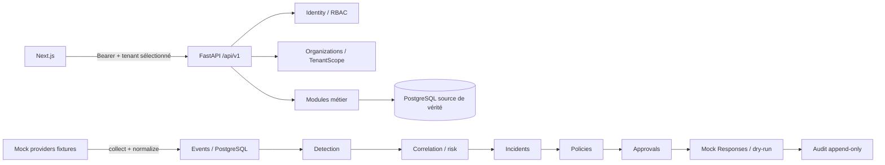

# Registre des décisions d'architecture

Les décisions ci-dessous établissent le cadre initial. Toute décision structurante ultérieure doit être ajoutée avec un identifiant ADR unique et son contexte, ses alternatives et ses conséquences.

## ADR-001

### Titre

Démarrer par un monolithe modulaire

### Contexte

Le projet doit livrer un MVP SOC/SIEM cohérent avant d'assumer le coût opérationnel de services distribués. Le document d'architecture du cadrage recommande de commencer par un monolithe modulaire et d'extraire des services seulement si un besoin est démontré.

### Solution retenue

Organiser le backend FastAPI en modules métier séparés avec des contrats explicites. Garder les responsabilités et dépendances visibles, sans déployer de microservices au démarrage.

### Alternatives rejetées

- Microservices dès le MVP : complexité opérationnelle et de coordination prématurée.
- Application monolithique sans frontières de modules : risque de couplage et de logique métier dispersée.

### Conséquences

- Les modules (identité, organisations, actifs, intégrations, événements, détection, corrélation, incidents, politiques, approbations, réponses et audit) peuvent évoluer dans un même déploiement.
- Les contrats entre modules et les dépendances devront être documentés et testés.
- Une extraction ultérieure nécessitera une justification basée sur les besoins mesurés.

## ADR-002

### Titre

Simuler les intégrations de sécurité pour le MVP

### Contexte

Le cadrage initial envisage des connexions aux produits Wazuh, Rspamd, ClamAV et MISP. La mission actuelle exige expressément des mocks et interdit toute installation réelle tant que le MVP n'est pas validé.

### Solution retenue

Fournir des intégrations simulées pour Wazuh, Rspamd, ClamAV et MISP. Les mocks reproduisent les contrats utiles à la plateforme et fournissent des données de test déterministes ou contrôlées. Aucun connecteur ne doit contacter un service réel ni exécuter une réponse sur un système externe.

### Alternatives rejetées

- Installer ou appeler les produits réels avant validation du MVP : hors périmètre et dépendant d'environnements non requis.
- Coupler la logique métier directement à chaque mock : rendrait le remplacement futur par un adaptateur réel plus risqué.

### Conséquences

- Les contrats de connecteur et l'ingestion doivent pouvoir être exercés sans produits tiers.
- Les données et résultats simulés doivent être identifiables comme tels.
- Les erreurs, indisponibilités, doublons et reprises doivent pouvoir être testés sans effet externe.
- Le passage à des intégrations réelles est une décision ultérieure, après validation explicite du MVP et revue de sécurité.

## ADR-003

### Titre

Adopter la stack de référence du cadrage sans présumer de son déploiement

### Contexte

Le cadrage et les instructions des agents convergent vers FastAPI/Python pour le backend, Next.js/TypeScript pour le frontend, PostgreSQL pour les données métier, et RabbitMQ/Redis pour les besoins de messagerie et de cache. L'authentification cible OIDC/Keycloak, simulée au début selon les instructions de l'Architect Agent. Aucun code, manifeste de dépendances ou environnement applicatif n'est encore présent dans le workspace.

### Solution retenue

Retenir cette stack comme architecture de référence du MVP, en appliquant les principes suivants :

- PostgreSQL est la référence envisagée pour les données métier.
- RabbitMQ et Redis sont des composants d'architecture envisagés pour le découplage et le cache, à intégrer selon les besoins du MVP.
- L'authentification commence par une simulation compatible avec les besoins de contrats ; l'intégration réelle à OIDC/Keycloak reste différée.
- Aucune installation ni dépendance applicative ne sera ajoutée avant la tâche qui en justifie l'usage.

### Alternatives rejetées

- Choisir une stack différente sans besoin documenté : duplication du cadrage et des conventions définies par les agents.
- Installer et configurer tous les composants avant la définition des modules : risque de travail prématuré, sans validation du besoin concret.

### Conséquences

- Les futurs modules doivent préserver des frontières permettant de substituer les services externes/infrastructure.
- Les choix précis de versions, bibliothèques, déploiement, persistance des événements et usage effectif de RabbitMQ/Redis restent à documenter lors de la conception du socle.

## ADR-004

### Titre

PostgreSQL comme source de vérité unique pour le prototype MVP

### Contexte

Le cadrage initial envisage PostgreSQL pour les données métier, un indexeur pour les événements, RabbitMQ pour le transport et Redis pour le cache. Le workspace ne contient pas encore d'application ni de services configurés ; le prototype doit être réellement exécutable avec des mocks uniquement, sans supposer qu'un indexeur ou un autre service est disponible.

### Solution retenue

- PostgreSQL persiste les organisations, identités locales de démonstration, appartenances/rôles, actifs, intégrations, événements normalisés et leur charge utile source, incidents/liens aux événements, politiques, approbations, réponses simulées et audit.
- Le stockage des événements reste relationnel/JSONB pour ce premier jeu de données et ce volume de prototype. Indexer externe, Redis et RabbitMQ sont différés ; aucune fonctionnalité MVP ne dépend d'eux.
- Les appels de collecte traitent les fixtures de façon synchrone et transactionnelle. Le contrat interne d'ingestion reste indépendant du transport, pour permettre une publication RabbitMQ ultérieure sans changer les DTO métier.
- Les clés étrangères composées ou vérifications équivalentes doivent garantir que les relations entre ressources d'organisation restent dans le même tenant. Les événements portent une contrainte unique `(organization_id, source, external_event_id)` ; les identifiants internes sont UUID et les dates UTC.

### Alternatives rejetées

- Exiger un cluster Wazuh Indexer/OpenSearch dès le prototype : élargit l'environnement et contredit l'objectif d'un lancement autonome avec mocks.
- Ajouter Redis/RabbitMQ sans consommateur asynchrone nécessaire au parcours de démonstration : introduit des composants non utilisés et une fausse impression de configuration.
- Stocker les événements uniquement en mémoire : perte au redémarrage et incapacité à valider l'idempotence/persistance.

### Conséquences

- La recherche MVP porte sur les colonnes indexées et le JSONB PostgreSQL ; les limites de volume et de recherche doivent être documentées.
- Le dashboard reflète des données persistées, pas des nombres de démonstration calculés séparément.
- PostgreSQL est la seule dépendance d'exécution hors application pour ce prototype. Aucun service externe n'est déclaré opérationnel tant qu'il n'a pas été effectivement fourni et testé.

## ADR-005

### Titre

Authentification simulée réservée au développement, autorisation réelle par rôle et tenant

### Contexte

Keycloak/OIDC est la cible mais n'est pas à installer pour le prototype. Les rôles fonctionnels du cahier sont Super administrateur, Administrateur sécurité, Analyste SOC, Opérateur, Auditeur et Observateur. Un simple `organization_id` envoyé par le navigateur ne constitue pas une identité ni une autorisation.

### Solution retenue

- Introduire une interface `PrincipalProvider` avec fournisseur `MockPrincipalProvider` activable uniquement par `APP_ENV=development` et `MOCK_AUTH_ENABLED=true`; le démarrage échoue si ce mode est demandé hors développement.
- `POST /api/v1/auth/mock-login` accepte uniquement `user_key` d'un catalogue de fixtures, puis retourne un jeton opaque aléatoire de démonstration. La table de session en mémoire est explicitement volatile ; un redémarrage invalide les jetons. Aucun mot de passe réel ni secret de fournisseur n'est collecté.
- Le client transmet le jeton en `Authorization: Bearer`. `GET /api/v1/auth/me` expose l'utilisateur, ses appartenances et permissions. `POST /api/v1/auth/mock-logout` invalide le jeton. L'interface utilise un adaptateur `AuthProvider` remplaçable par OIDC/PKCE ultérieurement.
- Les identifiants de fixtures sont publics et non utilisables en production. La simulation n'est pas un substitut à une validation JWT et n'autorise aucun accès à un environnement réel.
- Les permissions sont contrôlées côté API : lecture analyste/observateur/auditeur selon périmètre ; gestion des ressources par administrateur sécurité ; approbation par analyste ou administrateur habilité ; exécution simulée par opérateur habilité. Une séparation demandeur/approbateur est appliquée au MVP.

### Alternatives rejetées

- Accepter un utilisateur, rôle ou `organization_id` directement depuis un header non vérifié : usurpation triviale de contexte et rupture de l'isolation.
- Présenter un login simulé comme une sécurité OIDC : trompeur et dangereux.
- Installer Keycloak dans ce prototype : hors de la contrainte de simulation et non requis pour vérifier le parcours.

### Conséquences

- Les fixtures de démonstration, le jeton et le mode d'authentification doivent être clairement signalés dans l'UI et la documentation.
- Tests obligatoires : sans/jeton invalide = 401 ; rôle insuffisant = 403 ; appartenance inexistante = refus ; changement de tenant autorisé seulement si l'utilisateur possède cette appartenance.
- La migration OIDC devra remplacer l'adaptateur, pas la logique d'autorisation métier.

## ADR-006

### Titre

Connecteurs et moteur de réponse exclusivement simulés, sans réseau vers les produits

### Contexte

Les agents et la mission demandent des mocks Wazuh, Rspamd, ClamAV et MISP. Le prototype doit exécuter le pipeline de bout en bout sans accès à des systèmes tiers. Les mocks ne doivent ni installer ni contacter les produits réels.

### Solution retenue

- Chaque `MockConnector` implémente `health_check()`, `collect(cursor=None, since=None, limit=...)`, `normalize(raw_event)` et `validate(event)`. Les fournisseurs ne possèdent aucun client HTTP, URL configurable, socket ou commande shell vers le produit.
- Exposer `GET /api/v1/mock/{provider}/health` et les routes de fixture exigées par l'agent : `GET /api/v1/mock/wazuh/alerts`, `/rspamd/messages`, `/clamav/scans`, `/misp/iocs`. Elles retournent seulement les fixtures versionnées du dépôt avec `is_simulated=true`; bornes de pagination `limit` et curseur opaques.
- La collecte plateforme est `POST /api/v1/integrations/{integration_id}/collect` (rôle administrateur/analyste habilité), avec réponse `202` et `job_id`/`status` si l'exécution est différée ; le prototype synchrone peut répondre `200` avec compteurs et `run_id`. Le format de succès est uniforme et le choix final `200` synchrone est le contrat de départ.
- Les fixtures couvrent pour chaque famille les cas indiqués par l'agent SecurityIntegration ; un jeu compact déterministe couvre au minimum échec de connexion/brute force, malware, spam/phishing, fichier propre/infecté et IOC IP/domaine/hash. Toutes les valeurs sont synthétiques (plages d'adresses/documentation et noms réservés).
- Pipeline de collecte : fixture source -> validation/mapping vers `NormalizedEvent` -> déduplication persistée -> règles explicables -> corrélation dans une fenêtre de 15 minutes par tenant et actif (à défaut, tenant et clé d'indicateur) -> incident et liens d'événements -> proposition de réponse.
- Score initial déterministe borné 0–100 : sévérité info/low/medium/high/critical = 5/15/35/60/80, plus 10 par événement distinct corrélé après le premier, plafonné à 100. Sévérité high/critical ou score >=60 crée/actualise un incident ouvert ; les facteurs sont retournés et persistés.
- Réponse MVP = action de démonstration `simulate_containment`, jamais un changement d'actif/système. Elle nécessite une politique activée et une approbation distincte ; l'exécuteur mock retourne `simulated`, `verified=true` uniquement si la simulation s'est achevée, et écrit audit/résultat. Le kill switch `RESPONSES_ENABLED` est désactivé par défaut. Toute connexion ou action réelle est hors périmètre.

### Alternatives rejetées

- Connecteurs « mock » configurables par URL ou tombant silencieusement sur les vraies API : risque d'appel réel involontaire.
- Génération aléatoire non reproductible : rend déduplication et tests impossibles à vérifier.
- Exécuter de vraies actions après approbation : approbation humaine ne lève pas la contrainte d'absence d'effet externe.

### Conséquences

- L'état simulé est toujours visible dans les DTO, l'UI, les logs et l'audit.
- Les tests vérifient que le second traitement d'une même fixture ne crée ni événement ni incident doublon et qu'aucune sortie réseau n'est requise.
- Le mode temps réel « une alerte toutes les 30 secondes » suggéré par l'agent n'est pas requis pour le MVP ; il est différé pour garder le lancement déterministe.

## ADR-007

### Titre

Contrats de modules et flux HTTP versionnés pour le parcours vertical

### Contexte

Le cadrage définit des endpoints de ressources étendus et une architecture orientée événements. Le premier incrément doit toutefois vérifier une tranche fonctionnelle complète, dans un monolithe modulaire, avant d'ajouter la complexité d'un broker.

### Solution retenue

Modules et frontières :

| Module | Possède / expose | Dépendances autorisées |
|---|---|---|
| Identity | `Principal`, `Membership`, provider d'identité, rôle/permissions | Organizations |
| Organizations | organisation, tenant scope | aucune |
| Assets | actifs et DTO d'actif | Organizations |
| Integrations | configuration non secrète, état, collecte | Identity, Organizations, Events, connecteur mock |
| Events | DTO normalisé, repository, idempotence, recherche | Organizations, Integrations (contrat source) |
| Detection | résultat de règle et facteurs | Events |
| Correlation | regroupement et score | Events, Detection |
| Incidents | workflow, événement lié, commentaire | Correlation, Identity |
| Policies | schéma validé, règle et type d'action autorisé | Incidents |
| Approvals | décision, expiration et séparation demandeur/décideur | Incidents, Identity, Audit |
| Responses | orchestrateur et réponse mock | Policies, Approvals, Audit |
| Audit | journal append-only applicatif | Identity, Organizations |
| Reporting | agrégations tenant-scoped | Events, Incidents, Integrations, Responses |

`core` (configuration, erreurs, transaction, tenant context, horloge) peut être utilisé par les modules ; aucun module ne lit les tables d'un autre module directement hors repositories/contracts partagés. Les routes FastAPI adaptent HTTP et DTO uniquement ; logique métier dans services, persistance dans repositories. Dépendances injectées par interfaces.

Flux cible :

Enveloppe API succès : `{"data": ..., "meta":{"request_id":"uuid"}}`. Erreur : `{"error":{"code":"...","message":"...","details":[]},"meta":{"request_id":"uuid"}}`. DTO invalide = 422, non authentifié = 401, interdit = 403, ressource étrangère/invisible = 404, conflit d'état/d'idempotence = 409. Les erreurs ne contiennent ni secrets ni détails internes.

Contrats DTO Pydantic (noms JSON en snake_case, UUID, `datetime` ISO-8601 UTC, extras inconnus rejetés sur commandes) :

- `PrincipalDTO {user_id: UUID, user_key: str, display_name: str, memberships: MembershipDTO[]}` ; `MembershipDTO {organization_id: UUID, organization_name: str, role: Role}` ; rôles enum `super_admin|security_admin|soc_analyst|operator|auditor|observer`.
- `NormalizedEventDTO {event_id: UUID, organization_id: UUID, source: wazuh|rspamd|clamav|misp, integration_id: UUID, external_event_id: str, event_type: str, occurred_at: datetime, observed_at: datetime, severity: info|low|medium|high|critical, asset: {asset_id?: UUID, hostname?: str, ip_address?: str}, actor?: {username?: str}, message: str, indicators: IndicatorDTO[], raw_event: object, schema_version: "1.0", is_simulated: true}`. Limites initiales : message <= 2 000 caractères, événement sérialisé <= 64 KiB, lot <= 100.
- `IndicatorDTO {type: ip|domain|hash, value: str, confidence?: 0..100}`. Validation stricte des dates/tailles ; conserver la provenance et ne pas traiter automatiquement un IOC comme verdict.
- `IncidentDTO {id, organization_id, title, description?, severity, status: new|in_progress|resolved|closed, risk_score: 0..100, risk_factors: [{code, contribution, explanation}], assigned_to?, event_ids: UUID[], created_at, updated_at}`. Transitions autorisées : `new -> in_progress -> resolved -> closed`; clôture avec justification.
- `PolicyDTO {id, organization_id, name, enabled, trigger_min_severity?, trigger_min_score?, action_type: simulate_containment, approval_required: true}`. Pas d'exécution de code/expressions arbitraires JSON ; validation par schéma et liste blanche.
- `ApprovalDTO {id, organization_id, incident_id, response_id, status: pending|approved|rejected|expired, requested_by, decided_by?, justification?, expires_at, decided_at?}`. Décision unique, non expirée, acteur habilité et distinct du demandeur.
- `ResponseDTO {id, organization_id, incident_id, policy_id, approval_id, action_type: simulate_containment, status: proposed|approved|rejected|simulated|failed, idempotency_key, simulated: true, result?: {outcome: simulated|failed, verified: bool, message: str}}`.
- `AuditDTO {id, organization_id?, actor_user_id?, action, resource_type, resource_id?, outcome, metadata, correlation_id?, created_at}` ; metadata expurgée et sans secret.

Routes MVP minimales (toutes sous `/api/v1`) :

| Verbe / route | Entrée et résultat |
|---|---|
| POST `/auth/mock-login` | `{user_key}` -> jeton opaque de démo et principal ; refus si mode mock désactivé |
| GET `/auth/me`; POST `/auth/mock-logout` | principal/permissions ; invalider session |
| GET `/organizations`; GET `/organizations/{id}` | organisations accessibles au principal |
| GET/POST `/assets`; GET/PATCH `/assets/{id}` | CRUD MVP, tenant extrait du contexte d'autorisation |
| GET `/integrations`; POST `/integrations`; POST `/integrations/{id}/test` | uniquement `mock_*`, configuration sans secret |
| GET `/mock/{provider}/{resource}` | fixtures paginées, `is_simulated=true` |
| POST `/integrations/{id}/collect` | ingestion déterministe idempotente ; `{run_id, status, received, inserted, duplicates, incidents_created}` |
| GET `/events`; GET `/events/{id}` | filtres `from,to,source,asset_id,severity,event_type,cursor,limit` |
| GET `/incidents`; GET `/incidents/{id}`; POST `/incidents/{id}/status`; POST `/incidents/{id}/comments` | détail enrichi avec événements liés, commentaires, approbations et réponses ; workflow autorisé |
| GET/POST `/policies`; PATCH `/policies/{id}` | politiques validées ; désactivées par défaut |
| GET `/approvals`; POST `/approvals/{id}/approve`; POST `/approvals/{id}/reject` | décision avec justification requise |
| POST `/responses/{id}/dry-run`; POST `/responses/{id}/execute` | dry-run sans effet ; execute seulement si kill switch actif, rôle valide, politique, approbation distincte et en-tête `Idempotency-Key`, et toujours via mock |
| GET `/responses/{id}`; GET `/audit-logs`; GET `/dashboard/summary`; GET `/dashboard/timeline`; GET `/health/live`; GET `/health/ready` | résultats filtrés tenant ; KPI persistés et timeline sur 24 h ; readiness teste PostgreSQL seulement |

Les filtres temporels et pagination ont des limites (défaut 50, maximum 100); les réponses de listes sont `data: [...]` et `meta: {request_id, next_cursor?}`. Toute route ressource déduit son tenant de l'appartenance vérifiée et applique le filtre tenant dans la requête/repository avant lecture/écriture. La synthèse du dashboard expose `events_24h`, `incidents_open`, `incidents_critical`, `active_integrations` et `total_assets`. Les origines CORS sont une liste explicite d'origines locales configurée pour le portail ; aucun wildcard n'est autorisé.

### Alternatives rejetées

- Commencer par implémenter chaque CRUD du backlog avant de vérifier le flux collecte->incident : retarde la valeur opérationnelle du prototype.
- Ajouter d'emblée RabbitMQ/Redis et des workers sans contrat d'exécution nécessaire : accroît les modes de panne et contredit le démarrage autonome.
- Exposer les modèles ORM directement à l'API ou partager des requêtes SQL entre modules : couplage et dérive du contrat.

### Conséquences

- Les contrats ci-dessus sont la définition de travail pour OpenAPI et tests ; toute différence au moment de coder doit être documentée.
- Les routes de CRUD étendues du cadrage/backlog (commentaires riches, rapports PDF/CSV, administration utilisateurs complète) restent au-delà de la tranche verticale initiale.
- L'API est le seul canal du frontend vers les données métier ; aucun accès direct Next.js à PostgreSQL ou aux mocks.

## ADR-008

### Titre

Interface Next.js minimale et dépendances d'exécution réellement requises

### Contexte

L'agent Frontend décrit un portail avec Dashboard, Assets, Integrations, Events, Incidents, Policies, Approvals et Audit. Le besoin actuel est une tranche de prototype, pas l'affirmation qu'un portail ou des composants tiers sont déjà présents.

### Solution retenue

- Le frontend Next.js/TypeScript est un client API séparé. Pour l'incrément vertical, pages Login, Dashboard, Events et Incident détail (avec approbation/réponse simulée) constituent le parcours de démonstration ; Assets et Integrations exposent la préparation/collecte mock. Policies/Approvals/Audit peuvent être des vues minimales fonctionnelles selon l'ordre backlog.
- L'UI rend le statut de simulation, états loading/empty/error et refus d'accès. Pas de valeur KPI statique présentée comme résultat réel ; les KPI proviennent de `/dashboard/summary`.
- Le client utilise l'API FastAPI comme seul accès aux données et envoie le bearer token, le tenant actif et l'en-tête `Idempotency-Key` pour les actions qui le requièrent ; les origines CORS sont limitées aux origines locales configurées.
- Aucun client OIDC ne doit être configuré comme s'il existait. Le `AuthProvider` est remplacé ultérieurement par OIDC/PKCE ; aucune URL Keycloak n'est requise.
- Dépendances à démarrer pour le prototype : application FastAPI, PostgreSQL, application Next.js. RabbitMQ, Redis, Keycloak, OpenSearch/Wazuh Indexer et produits Wazuh/Rspamd/ClamAV/MISP sont explicitement absents du parcours MVP et ne doivent pas apparaître comme configurés/healthy.

### Alternatives rejetées

- Exiger toute la stack de production pour lancer l'UI ou l'API : empêche de vérifier le parcours mock.
- Produire une interface décorative alimentée par des fixtures locales indépendantes du backend : masque les erreurs d'API et de tenant.

### Conséquences

- Les futures tâches doivent inclure des tests de contrat API/UI, l'indication de mode simulation et des contrôles de lancement ne référençant aucun endpoint tiers.
- Les versions et dépendances exactes restent à choisir au moment de créer les manifestes, sans les inventer dans cette décision documentaire.

## ADR-009

### Titre

Convention tenant explicite, fail-closed et vérifiable

### Contexte

L'isolation organisationnelle est exigence P0. Les identifiants d'organisation figurent dans les DTO et les données, mais leur présence seule ne constitue pas un contrôle d'accès.

### Solution retenue

- Le tenant actif vient d'un identifiant de contexte de requête (header `X-Organization-ID` ou paramètre de route selon contrat HTTP), mais chaque requête le valide côté serveur contre le Principal authentifié et son appartenance active. Pour les opérations sans tenant explicitement choisi, accepter seulement une sélection non ambiguë ; sinon répondre 400 `TENANT_REQUIRED`.
- Aucun body de commande ne peut déterminer ou remplacer le tenant. Les créations utilisent le tenant résolu ; si un body contient un tenant différent, rejeter 403/422.
- Tous les services/repositories métier exigent un `TenantContext` non-null, sauf les opérations globales explicitement réservées au super administrateur et auditées. Les lectures, mises à jour et suppressions sont filtrées par `(organization_id, id)` ; une ressource d'un autre tenant est indistinguable d'une ressource absente (404).
- Les relations tenant-scoped (incident/événement, incident/approbation, réponse/politique, actif/intégration) sont vérifiées dans la même transaction ; employer des clés étrangères composées quand réalisable. Les tâches/background transmettent un `organization_id` immuable et le revérifient.
- Le schéma renforce les liens disponibles par des contraintes composites `(organization_id, id)` ou `(organization_id, user_id)` : événement/intégration, incident/événement, incident/commentaire, incident/réponse/approbation, réponse/politique, et acteurs membres de la même organisation.
- Ajouter tests d'isolation croisés sur listes, détail, recherche, création liée, mutation, approbation et réponses : un utilisateur du tenant A ne récupère ni ne modifie aucun objet du tenant B, y compris via UUID connu.
- Audit d'une opération tenantée porte le tenant résolu ; ne jamais écrire des payloads bruts/secrets par défaut.

### Alternatives rejetées

- Faire confiance à un `organization_id` du body/header sans vérifier l'appartenance.
- Se limiter à filtrer l'interface, ou filtrer la liste sans contrôler le détail et les ressources liées.
- Laisser un contexte tenant absent devenir une requête globale.

### Conséquences

- Le `TenantContext` est une dépendance obligatoire pour chaque route métier et repository.
- Une revue croisée de sécurité devra vérifier le chemin complet route -> service -> repository et tester des UUID inter-tenant avant toute validation MVP.
- La stack de référence ne constitue pas la preuve que ses services sont déjà installés ou opérationnels.

## ADR-010

### Titre

Décisions d'approbation atomiques et contraintes relationnelles tenant-aware

### Contexte

La revue croisée a identifié un risque de concurrence lors de décisions simultanées d'approbation et l'absence de contraintes PostgreSQL assurant que certains liens entre lignes appartiennent à la même organisation. Les vérifications applicatives tenantées demeurent obligatoires, mais ne remplacent pas les invariants de stockage.

### Solution retenue

- Une décision d'approbation est une mise à jour conditionnelle atomique (`status = pending`, échéance non passée, tenant attendu). Une seule requête concurrente peut modifier la ligne ; si aucune ligne n'est mise à jour, l'API retourne un conflit ou l'état expiré et n'écrit ni réponse ni audit de succès.
- Les relations tenant-scoped réalisables sont protégées par des clés étrangères composites, avec clés uniques correspondantes `(organization_id, id)`. Les demandeurs, décideurs et auteurs de commentaires doivent également être membres de l'organisation référencée.
- Les tests SQLite activent explicitement les clés étrangères afin que les tests d'isolation détectent les références inter-tenant invalides.

### Alternatives rejetées

- Lire puis modifier l'approbation sans condition atomique : une deuxième transaction pourrait écraser la décision de la première.
- S'appuyer uniquement sur les contrôles de service pour garantir la cohérence tenant : les scripts, tâches et évolutions futures peuvent contourner ces contrôles.
- Tester SQLite avec les clés étrangères désactivées : masquerait l'absence d'invariants relationnels.

### Conséquences

- La migration initiale crée les clés composites ; les déploiements existants devront appliquer une migration versionnée supplémentaire si cette base a déjà été créée ou contient des données.
- Les contraintes sont vérifiées avec SQLite dans les tests et la compilation Alembic ; leur exécution PostgreSQL et le comportement de concurrence réel restent à valider sur une instance PostgreSQL avant acceptation.
- L'orchestration reste centralisée dans `backend/app/services.py` pour l'incrément actuel ; les frontières de modules explicites définies dans ADR-007 ne sont donc pas encore matérialisées pour tous les cas d'usage. Cette dette est suivie dans le journal et doit être résolue avant extension importante ou usage de production.
